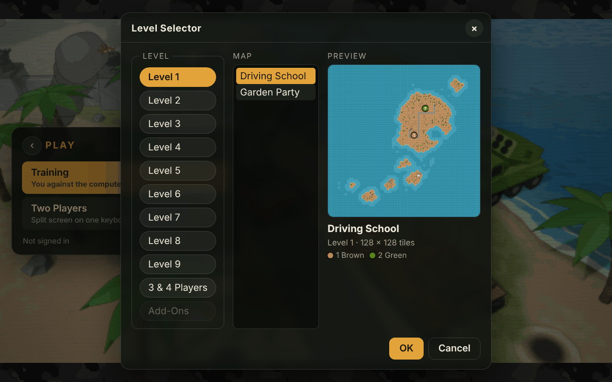
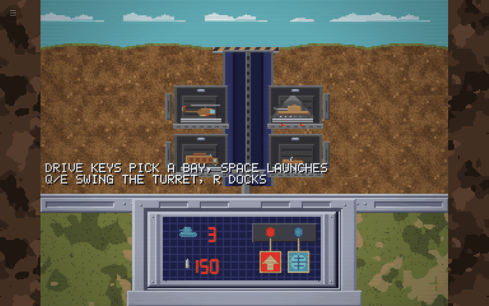
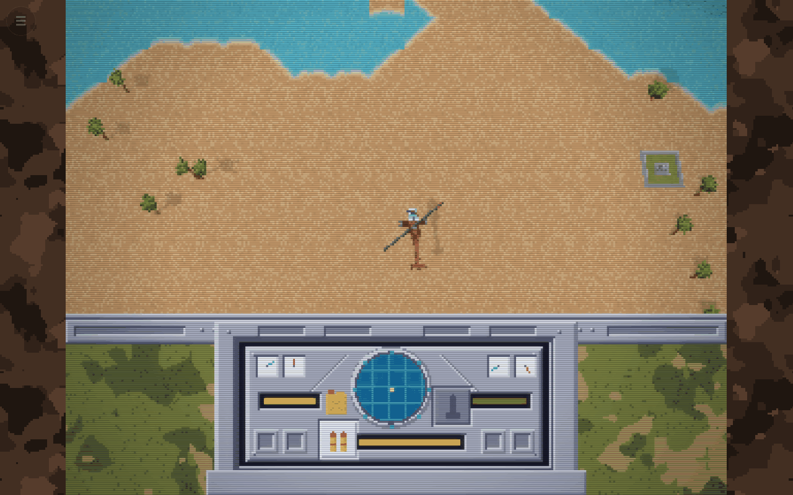

# How to Play

This page covers the menus and the controls. What wins a match and what each vehicle is for is on [[Game Rules]].

## Starting a match

The title screen shows the menu after the splash. Any key or a tap brings it back after Esc.

| Menu item | What it starts |
| --- | --- |
| **Play > Training** | You against the computer in one full-screen view |
| **Play > Two Players** | Two players on one keyboard in split screen (desktop only) |
| **Online** | Matches with other people. See [[Online Play]] |
| **Replays** | Your recorded matches |
| **Level Editor** | Make your own maps (desktop only). See [[Level Editor]] |
| **Options** | Controls, sound, picture and Swap Sides |

Training and Two Players open the **Player Selector** (names and the computer's skill, 1 to 9), then the **Level Selector**, which lists the maps by level 1 to 9 with a preview of each. On a map with three or four bases you are also asked for the team layout.

*The Level Selector: levels on the left, that level's maps, and a preview of the picked map with each base marked.*

## Your first match

1. You start in your bunker on the lift screen. Pick a vehicle with **1 2 3 4** (jeep, tank, ASV, helicopter).
2. Take a tank or a helicopter first and find the enemy base. Destroy its buildings until the flag appears.
3. Drive back onto your own base and press **R** to go back into the bunker.
4. Launch a jeep, drive it over the flag to pick it up, and bring it home.

*The lift screen. The four bays hold the helicopter, tank, ASV and jeep, and the panel shows how many of the picked vehicle are left.*

*Just launched: a tank beside its base's lift pad. Drive back onto the pad and press R to dock.*

## Controls

**H** in the game lists every key, always showing the keys in use.

| | Player 1 (Brown) | Player 2 (Green, Two Players) |
| --- | --- | --- |
| Drive | W A S D | Arrow keys |
| Fire | Space | Enter |
| Second button | Left Shift | Right Shift |
| Third button | F | / |
| Tank turret (both together centre it) | Q / E | [ / ] |
| Go back into the bunker (on your base) | R | Backspace |
| Launch jeep, tank, ASV, helicopter | 1 2 3 4 | 7 8 9 0 |

What the second and third buttons do depends on the vehicle:

| Vehicle | Second button | Third button |
| --- | --- | --- |
| Jeep | Float the tyres in water | Put down or pick up a flag |
| Tank | Fire raised at aircraft | |
| ASV | Fire raised at aircraft | Lay a mine |
| Helicopter | Fire straight ahead | Swap gun and missiles |

On the lift screen the drive keys and fire also pick and launch a vehicle.

With one player (Training, online and the editor's test play) either half of the keyboard works. **Options > Controls** rebinds any vehicle key. There is no gamepad support.

## Shortcuts

| Key | Does |
| --- | --- |
| H | Controls and Keys |
| N | New Game |
| P | Pause or resume (not online) |
| Alt+R | Restart |
| M | Open the menu |
| L | Hall of Fame |
| V | Sound off or on |
| Alt+Enter | Full screen |
| Alt+3 | Swap Sides (player 1 takes the right-hand keys) |
| Esc | Leave the game |

Online only:

| Key | Does |
| --- | --- |
| T | Open the chat line. Tab picks everyone, your team or one player; Enter sends; Esc closes |
| Tab (hold) | The scoreboard |
| 1 to 4 | Spectators: follow that player |

In the menus, the arrow keys move, Enter or Space picks, and Esc goes back. A mouse or a finger works as well.

## Phones and tablets

Phones and tablets play solo, in landscape, with faded on-screen buttons. Held upright, the game asks you to turn the device and the match waits. Two Players and the level editor are desktop only.

| Control | Does |
| --- | --- |
| Stick (left thumb, lower left) | Drive and turn. On the lift screen, pick a bay |
| Fire (right corner) | Fire. Launch on the lift screen |
| Tyres / Flag | Jeep: float the tyres; put down or pick up a flag |
| AA | Tank and ASV: fire raised at aircraft |
| Mine | ASV: lay a mine |
| Ahead / Swap | Helicopter: fire straight ahead; swap gun and missiles |
| ◀ ● ▶ | Tank: swing the turret, ● centres it. Helicopter: strafe |
| Jeep, Tank, ASV, Heli (top, lift screen) | Launch that vehicle |
| Dock (top, while driving) | Back into the bunker on your base |
| ❚❚ / ☰ | Pause / the menu |

## The screen

- **The bars** show fuel, ammunition and damage for the vehicle you are driving.
- **The radar** shows what is around you.
- **The camouflage bars** beside the picture are in the colour of the player being watched.

*The helicopter's panel has its own gauges. The camouflage bars at the sides are brown because Brown is being watched.*

*Two Players: Brown on the left half, Green on the right, each with their own panel.*

## Replays

Every match is recorded in your browser: the last 20, plus any you star. A replay plays at ¼× to 8× speed.

| Key | Does |
| --- | --- |
| - / = | Slower / faster |
| , / . | Ten seconds back / on |
| P | Pause |
| 1 to 4 | Follow that player |
| Alt+R | Start again |
| Esc | Leave |

Replays save as `.rfwreplay.json` files or, signed in, to your account.

## Options

- **Controls:** rebind every vehicle key for either half of the keyboard.
- **Sound:** master, effects and music volume.
- **Visuals:** Retro (the original's 320 × 240 pixel picture, the default) or Modern (the same game in 3D at 1280 × 720, with lighting, shadows and effects). You can switch during a match; the game plays the same either way.
- **Picture:** a subtle CRT look (on by default, retro only) and how the picture is scaled.
- **Swap Sides:** gives player 1 the right-hand keys.

Names, settings and the Hall of Fame are kept in your browser. Signed in, your settings follow your account.
