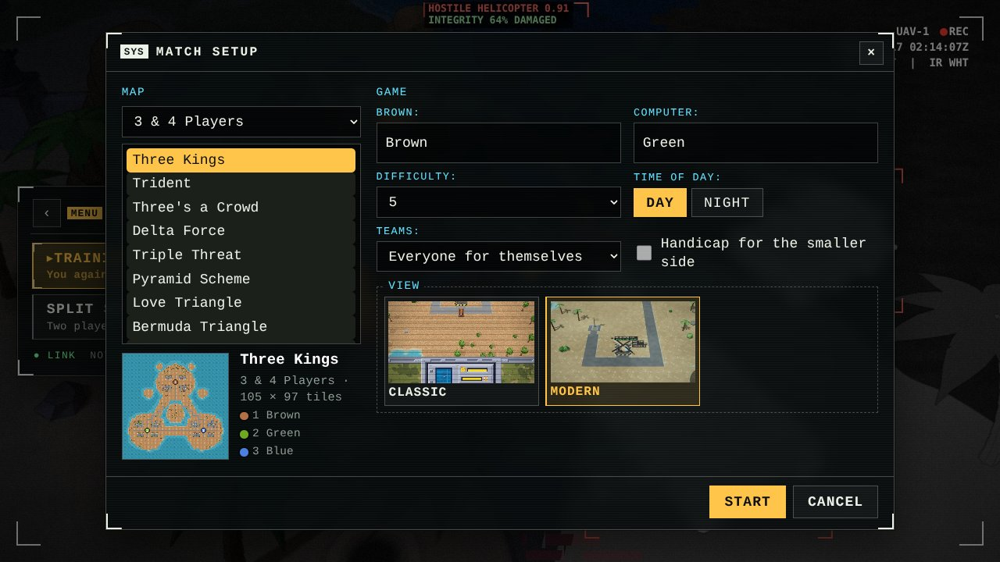
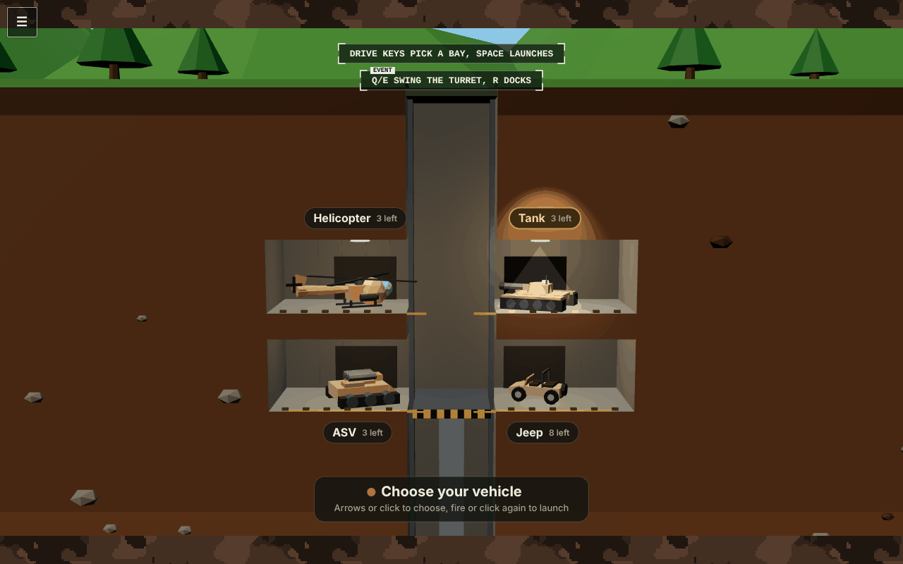
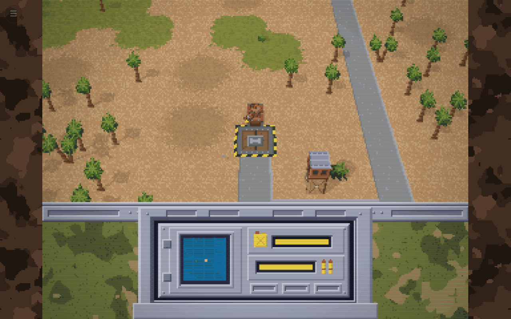
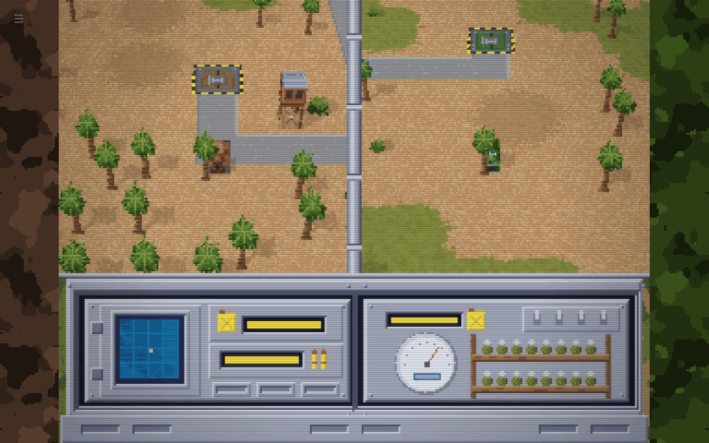
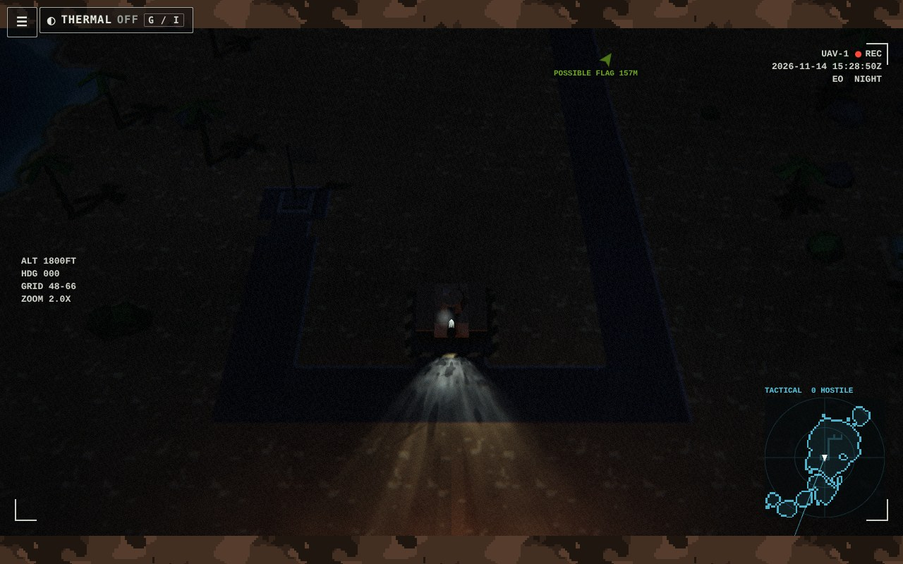
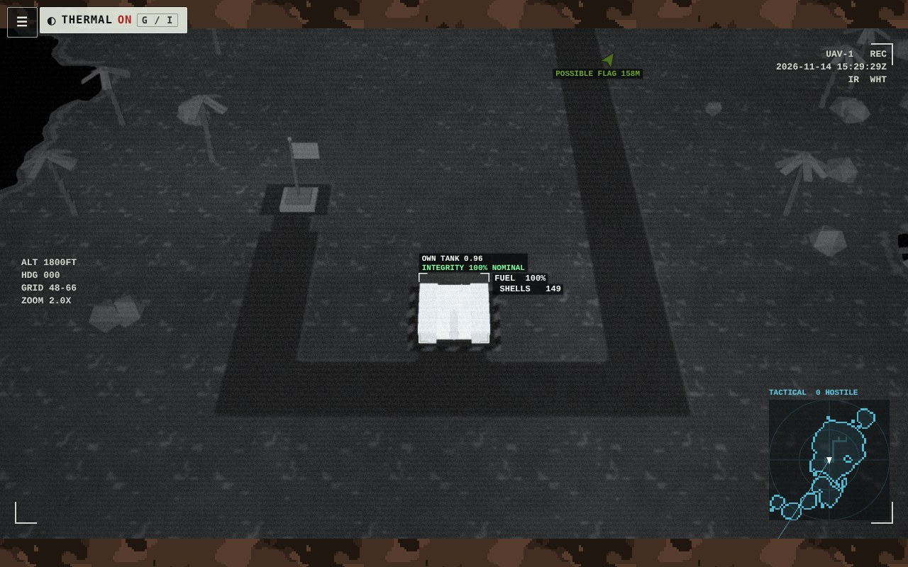

# How to Play

This page covers the menus and the controls. What wins a match and what each vehicle is for is on [[Game Rules]].

## Starting a match

The title screen shows the menu after the splash. Any key or a tap brings it back after Esc.

| Menu item | What it starts |
| --- | --- |
| **Local Play > Training** | You against the computer in one full-screen view |
| **Local Play > Split Screen** | Two players on one keyboard in split screen (desktop only) |
| **Online** | Matches with other people. See [[Online Play]] |
| **Replays** | Your recorded matches |
| **Level Editor** | Make your own maps (desktop only). See [[Level Editor]] |
| **Options** | Controls, sound, picture and Swap Sides |

Training and Split Screen open **Match Setup**, one screen laid out like an online lobby. On the left is the map: pick Level 1 to 9, 3 & 4 Players or Add-Ons, then a map, with a preview of it and its bases. On the right are the names, the difficulty (1 to 9), the time of day (Day or Night), the teams on a map with three or four bases, and the view: Classic or Modern, each with a preview. Start begins the match.

*Match Setup on a four-base map: the map on the left, the game on the right.*

After the match, the **results** show who won, the time, and each player's flags brought home, vehicles lost and vehicles left. Rematch plays the same map again with the same settings, Watch Replay plays the match back, and Title Screen goes back to the menu. Online, the results go back to the lobby.

## Your first match

1. You start in your bunker on the lift screen. Pick a vehicle with **1 2 3 4** (jeep, tank, ASV, helicopter).
2. Take a tank or a helicopter first and find the enemy base. Destroy its buildings until the flag appears.
3. Drive back onto your own base and press **R** to go back into the bunker.
4. Launch a jeep, drive it over the flag to pick it up, and bring it home.

*The bunker in the modern view. The four bays hold the helicopter, tank, ASV and jeep, each with how many are left. Tap or click a bay to pick it, and again to launch.*

*The same lift screen in the classic view, where the panel shows how many of the picked vehicle are left.*

*Just launched, in the classic view: a tank beside its base's lift pad. Drive back onto the pad and press R to dock.*

## Controls

**H** in the game lists every key, always showing the keys in use.

| | Player 1 (Brown) | Player 2 (Green, Split Screen) |
| --- | --- | --- |
| Drive | W A S D | Arrow keys |
| Fire | Space | Enter |
| Second button | Left Shift | Right Shift |
| Third button | F | / |
| Tank turret (both together centre it) | Q / E | [ / ] |
| Go back into the bunker (on your base) | R | Backspace |
| Launch jeep, tank, ASV, helicopter | 1 2 3 4 | 7 8 9 0 |
| Thermal camera on / off (modern view, at night) | G | I |

What the second and third buttons do depends on the vehicle:

| Vehicle | Second button | Third button |
| --- | --- | --- |
| Jeep | Float the tyres in water | Put down or pick up a flag |
| Tank | Fire raised at aircraft | |
| ASV | Fire raised at aircraft | Lay a mine |
| Helicopter | Fire straight ahead | Swap gun and missiles |

On the lift screen the drive keys and fire also pick and launch a vehicle, or click a bay to pick it and click it again to launch.

With one player (Training, online and the editor's test play) either half of the keyboard works. **Options > Controls > Vehicle Keys** rebinds any vehicle key. There is no gamepad support.

## Shortcuts

| Key | Does |
| --- | --- |
| H | Help Topics, in pages: How to Play, Keys, Views, Online and More. **Help** in the menu also has System Info and About |
| N | New Game |
| P | Pause or resume (not online) |
| Alt+R | Restart |
| M | Open the menu |
| L | Hall of Fame |
| V | Sound off or on |
| Alt+Enter | Full screen (computers; phones and tablets are always full screen) |
| Alt+3 | Swap Sides (player 1 takes the right-hand keys) |
| Esc | Pause menu: Resume, Options, Help, Leave Match. Offline the match waits; online it carries on |

Online only:

| Key | Does |
| --- | --- |
| T | Open the chat line. Tab picks everyone, your team or one player; Enter sends; Esc closes |
| Tab (hold) | The scoreboard |
| 1 to 4 | Spectators: follow that player (← and → step through them) |

In the menus, the arrow keys move, Enter or Space picks, and Esc goes back. A mouse or a finger works as well.

## Phones and tablets

Phones and tablets play solo, in landscape and full screen, with faded on-screen buttons. Computers never show the buttons, even with a touch screen. Split Screen and the level editor are desktop only.

Before the title screen the game asks you to:

1. **Turn your device sideways.** Held upright, a notice covers the screen until you do.
2. **Tap to play full screen.** One tap puts the game full screen, and locks it in landscape where the phone allows it.

If you turn the device upright or leave full screen later, the same notice comes back and an offline match waits until you put it right (one tap goes back to full screen). The Full Screen option is not in the menu on phones and tablets, since the game is always full screen there.

**iPhone:** Safari on an iPhone cannot put a web page full screen, so there the game only asks for landscape, and the title screen says once how to get full screen instead: tap **Share**, then **Add to Home Screen**, and start the game from its home screen icon. It then opens full screen in landscape.

| Control | Does |
| --- | --- |
| Stick (left thumb, lower left) | Point the way to go: the vehicle turns to face that way and drives there; let go to stop |
| Tap a bay (lift screen) | Pick that vehicle; tap it again to launch |
| Fire (right corner) | Fire. Launch on the lift screen |
| Tyres / Flag | Jeep: float the tyres; put down or pick up a flag |
| AA | Tank and ASV: fire raised at aircraft |
| Mine | ASV: lay a mine |
| Ahead / Swap | Helicopter: fire straight ahead; swap gun and missiles |
| ◀ ● ▶ | Tank: swing the turret, ● centres it. Helicopter: strafe |
| Jeep, Tank, ASV, Heli (top, lift screen) | Launch that vehicle |
| Dock (top, while driving) | Back into the bunker on your base |
| P1 to P4 (top, once you are out) | Watch that player |
| ❚❚ / ☰ | Pause / the menu |

## The screen

- **The bars** show fuel, ammunition and damage for the vehicle you are driving.
- **The radar** shows what is around you.
- **The camouflage bars** beside the picture are in the colour of the player being watched.

*The helicopter's panel has its own gauges. The camouflage bars at the sides are brown because Brown is being watched.*

*Split Screen: Brown on the left half, Green on the right, each with their own panel.*

## Replays

Every match is recorded in your browser: the last 20, plus any you star. A replay plays at ¼× to 8× speed.

| Key | Does |
| --- | --- |
| - / = | Slower / faster |
| , / . | Ten seconds back / on |
| P | Pause |
| 1 to 4 | Follow that player |
| C | Free camera on / off |
| W A S D or the arrows | Move the free camera |
| Q / E (or Page Down / Page Up) | Zoom the free camera out / in |
| Alt+R | Start again |
| Esc | Leave |

The **free camera** looks anywhere on the map: drag the picture with the mouse or a finger, and zoom with the mouse wheel or a two-finger pinch. Moving or zooming turns it on, and picking a player on the bar goes back to following them. It works while the replay is paused too. In the modern view it zooms from close in to the whole island; the classic view zooms out but no closer than its own pixels.

Replays save as `.rfwreplay.json` files or, signed in, to your account.

## Options

- **Controls:** rebind every vehicle key for either half of the keyboard.
- **Sound:** master, effects and music volume. The retro view plays a military band; the modern view has a hardcore and metalcore soundtrack of its own.
- **Instruments:** Built-in (the default) or Sampled, which plays the retro band from real instrument samples (the GeneralUser GS SoundFont). The first time you pick Sampled the game downloads it (32 MB); after that your browser keeps it. The modern soundtrack keeps its own guitars and drums either way.
- **Visuals** (also **Style** on the main menu, which swaps the title picture too): Modern (the default: the game in 3D at 1280 × 720, with lighting, shadows and effects, a 3D bunker and skull, and modern messages and scoreboard) or Classic (the original's 320 × 240 pixel picture with a subtle CRT look). The game remembers your pick. You can switch during a match; the game plays the same either way. The modern view is a surveillance drone's feed: grain, a lens, stream errors when something blows up nearby (worst when you are hit), and an overlay of the clock, altitude and grid. In a modern match at night, the **THERMAL** button beside the menu button, or its key (**G** left hand, **I** right hand, changed in Options > Controls > Vehicle Keys), switches to a white-hot thermal camera that sees in the dark; each match starts with it off, and by day there is no thermal camera. Arrows at the edges in each rival's colour point to its flag buildings (any of them may hide the flag), to a flag lying in the open, and home while your jeep carries one.
- **Time of day** (on Match Setup, or the host's pick online; not in Options): Day or Night. Night is dark: each vehicle has its own lights (the jeep's twin headlamps and red tail lights, the tank's hooded blackout lamps, the ASV's navigation lights and sweeping searchlight, and the helicopter's searchlight, navigation lights and flashing red tail beacon), explosions light up the ground, and street lamps, watchtowers and windows are lit. The lights are not clean discs: beams carry grime and scratches, and lamps throw the bars of their cages and flicker. Every lamp is lit, and lamps and headlights cast shadows: buildings and trees block their light (and vehicles block headlights).

*A night match in the modern view: only the headlights, lamps and fires light the ground. THERMAL, top left, is off.*

*The same spot with the thermal camera on: the tank runs white-hot against the cool ground.*

- **Quality** (Options > View, modern view only): Auto (the default), Low, Medium, High or Ultra. It is each device's own setting, even online, and the game remembers it in this browser. The presets change how much a frame costs, never what you see in the match: the 3D picture's resolution, shadows, which headlights cast shadows, the focus blur and how much of the garden's scatter is drawn. Auto starts on High (Medium on phones and tablets) and steps down if the device cannot keep up. Dynamic resolution then holds 60 frames a second (30 on phones and tablets) by drawing the 3D picture a little smaller while the device falls behind; the HUD stays sharp.
- **Tilt-Shift** (Options > View, modern view only): On (the default) or Off. The tilt-shift focus keeps a band across the middle of the drone feed sharp and softens the top and bottom, so the battlefield reads as a miniature; switch it off for a picture that is sharp all over. Like Quality it is each device's own setting, remembered in this browser. Low quality always leaves it off.
- **Picture:** how the classic picture is scaled.
- **Swap Sides:** gives player 1 the right-hand keys.

Names, settings and the Hall of Fame are kept in your browser. Signed in, your settings follow your account.

## Achievements

There are fifty achievements to earn. Title > Achievements (or the pause menu) lists them all, with your progress towards the ones that count, and each one pops up as you earn it: as a computer-vision lock-on in the modern view, and as a pixel panel in the classic view.

Without an account they are kept in this browser. Signed in, they are kept on your account, and whatever you earned before signing in moves to the account. Offline, the achievements follow the first player; wins count against the computer or another player, not against empty bases. The online ones are awarded by the server from its own copy of the match, so they cannot be claimed from a browser.

| Group | Achievement | How to earn it |
|---|---|---|
| Missions | Reporting for Duty | Finish a match. |
| Missions | First Victory | Win a match. |
| Missions | Veteran | Win 25 matches. |
| Missions | War Hero | Win 100 matches. |
| Missions | Top Brass | Win against the computer at skill 9. |
| Missions | Not a Scratch | Win a match without losing a vehicle. |
| Missions | Blitzkrieg | Win a match in under five minutes. |
| Missions | By a Thread | Win with no jeeps left in the bunker. |
| Missions | Night Owl | Win a match at night. |
| Missions | Three's a Crowd | Win on a map with three bases. |
| Missions | Last One Standing | Win a four-base free-for-all. |
| Missions | Tour of Duty | Win on 10 different maps. |
| Missions | Off the Beaten Track | Win on a map from the library or the level editor. |
| Missions | Couch Commanders | Finish a two-player split-screen match. |
| Combat | First Blood | Destroy an enemy vehicle. |
| Combat | Scrap Dealer | Destroy 50 enemy vehicles. |
| Combat | Wrecking Crew | Destroy 250 enemy vehicles. |
| Combat | Tank Hunter | Destroy 25 enemy tanks. |
| Combat | Clipped Wings | Shoot down 10 enemy helicopters. |
| Combat | Combined Arms | Destroy an enemy vehicle with each of your four vehicles. |
| Combat | David and Goliath | Destroy a tank while driving a jeep. |
| Combat | Hat Trick | Destroy three enemy vehicles in one sortie. |
| Combat | Rampage | Destroy five enemy vehicles in one sortie. |
| Combat | Interception | Destroy the jeep carrying your flag. |
| Combat | Swatter | Shoot down an attack drone. |
| Combat | Pest Control | Shoot down 25 attack drones. |
| Combat | Body Count | Take out 100 enemy soldiers. |
| Demolition | Tower Down | Destroy a gun tower. |
| Demolition | Tower Toppler | Destroy 50 gun towers. |
| Demolition | Urban Renewal | Destroy 500 buildings. |
| Demolition | Jailbreak | Destroy an enemy prison. |
| Demolition | A Bridge Too Far | Destroy a bridge. |
| Demolition | Fireworks | Blow up an enemy fuel depot. |
| Demolition | Lawnmower | Flatten 50 bushes, trees, planters or tents. |
| Flags | Snatch and Grab | Pick up an enemy flag. |
| Flags | Capture the Flag | Bring an enemy flag home. |
| Flags | Flag Collector | Capture 10 enemy flags. |
| Flags | Homecoming | Bring your own flag back home. |
| Vehicles | Full Motor Pool | Launch all four vehicles in one match. |
| Vehicles | Amphibious | Blow up the jeep's tyres and float. |
| Vehicles | Minefield | Lay 50 mines with the ASV. |
| Vehicles | Here Be Monsters | Lose a helicopter to the submarine. |
| Vehicles | Davy Jones | Sink a vehicle in deep water. |
| Online | Going Live | Finish an online match. |
| Online | Online Victory | Win an online match against another player. |
| Online | Brothers in Arms | Win an online match alongside another player. |
| Online | Climbing the Ladder | Reach a ladder rating of 1100. |
| Extras | Instant Replay | Watch a replay. |
| Extras | Architect | Save a map in the level editor. |
| Extras | Heat Signature | Switch on the thermal camera at night. |
