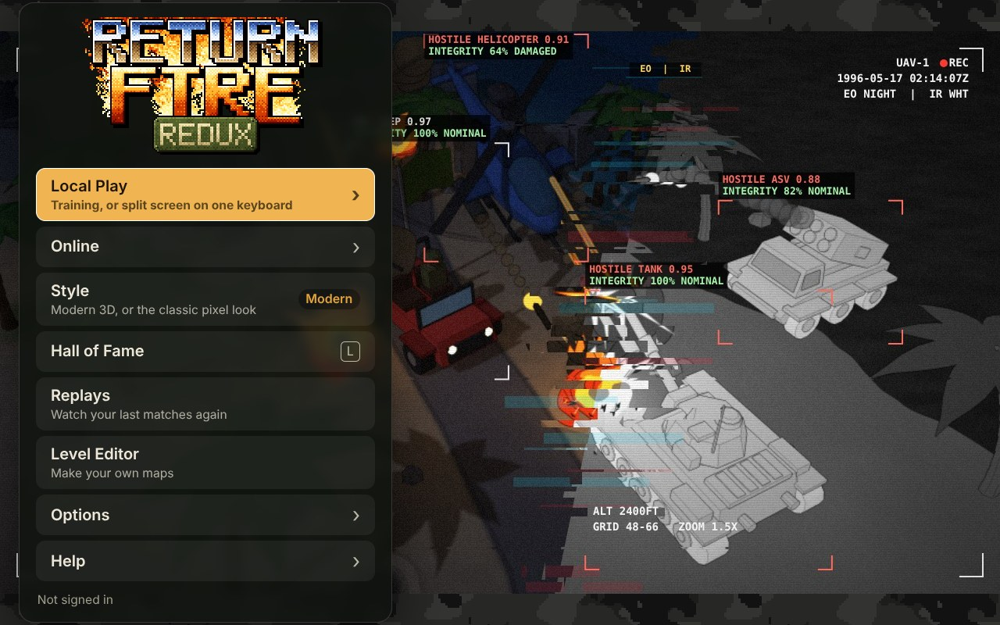

# Installation

This page gets the game running on your own computer. To host it for other people, see [[Deployment]].

There are two ways. Docker is the quickest if you only want to play. Node.js is the way to go if you want to change the game.

## With Docker

You need [Docker](https://docs.docker.com/get-docker/) with Compose v2.

1. Open the latest release on the [Releases page](https://github.com/zombiecheese/rf-redux/releases) and download `docker-compose.yml`, `env.example` and `Caddyfile` into one empty folder.
2. Copy `env.example` to `.env` and set the three owner settings. They make your own account on the site:

   ```sh
   RF_OWNER_NAME=YourName
   RF_OWNER_EMAIL=you@example.com
   RF_OWNER_PASSWORD=a-long-password
   ```
3. Start it:

   ```sh
   docker compose up -d
   ```
4. Open http://localhost:8080.

Stop it with `docker compose down`. Your accounts and maps are kept in a Docker volume until you run `docker compose down -v`.

## With Node.js

You need [Node.js 22](https://nodejs.org/) and Git.

```sh
git clone https://github.com/zombiecheese/rf-redux.git
cd rf-redux
npm install
npm run dev
```

Open http://localhost:5173. This is the development server: it reloads when a file changes. Training, Split Screen, replays and the level editor all work straight away.

Online play needs the game server as well. In a second terminal:

```sh
npm run build -w @rfw/server
npm start
```

Open http://localhost:5173 in two browser windows (one of them private) to play against yourself.

To run the finished build without the development server:

```sh
npm run build
npm start
```

Then open http://localhost:8080.

## Checking it works

- The Zombiecheese Productions splash plays, then the title screen shows the menu.
- **Local Play > Training** starts a match against the computer.
- **H** in a match lists every key.



*What you should see once the splash has played.*

If something does not start, see [[Troubleshooting]].

## Starting a match from the address bar

Add these to the address to skip the menus, which is handy for testing:

| Option | Does |
| --- | --- |
| `?mode=solo` or `?mode=local2` | Starts Training or Split Screen at once |
| `?map=rfmap101` | Picks the map: `rfmap101` to `rfmap204`, `tri01` to `tri08` (three bases), `quad01` to `quad08` (four bases) |
| `?difficulty=1` to `9` | Sets the computer's skill (default 5) |
| `?bots=0` | Solo with no computer opponent |
| `?seed=N` | Fixes the random seed |
| `?scale=integer` | Scales the picture by whole numbers only |
