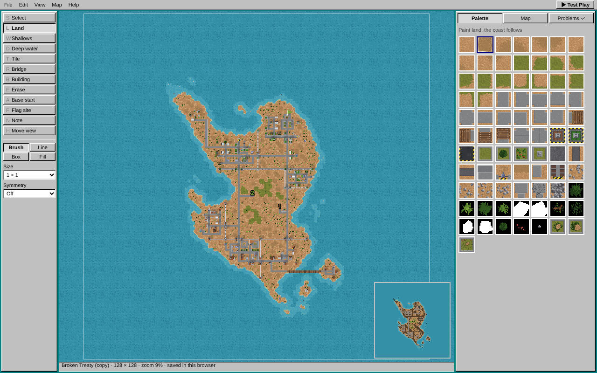
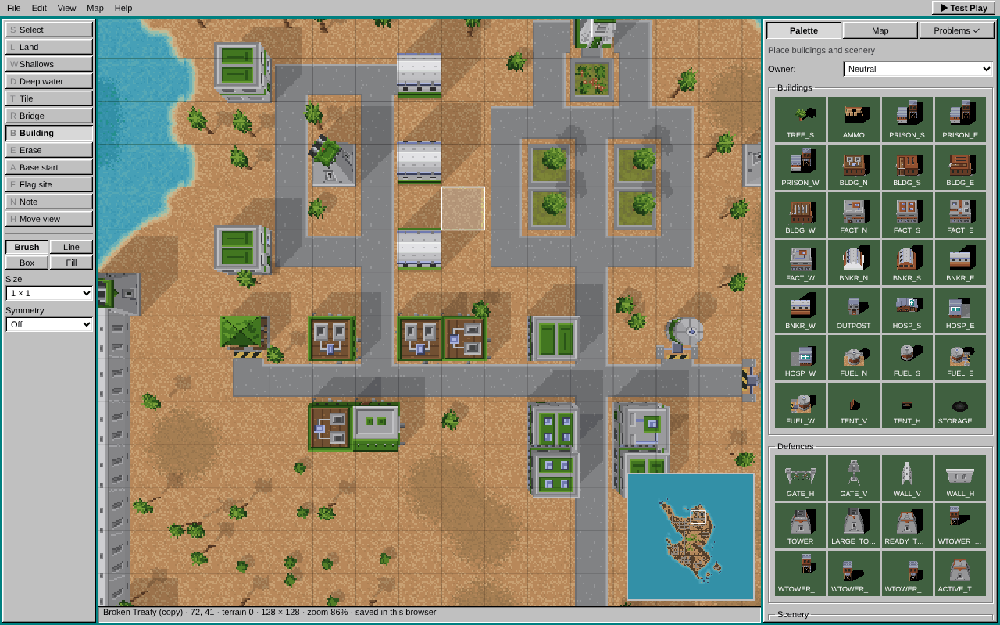

# Level Editor

The level editor is **Level Editor** in the main menu, or `/editor.html`. It needs a mouse and a keyboard, so it is desktop only. It draws the map with the game's own renderer, so a map looks the same in the editor as in a match.

## The layout

- **Tools** on the left, each with a key.
- **The map** in the middle, top down or in the game's tilted view (Tab). The wheel zooms, a right-drag or Space and drag pans, and 0 fits the whole map.
- **The side panel** on the right: the palette for the current tool, the Map tab and the Problems tab.

*A whole map in the editor, with the tools on the left, the palette on the right and the minimap in the corner. The numbers mark each base's start.*

| Tool | Key | Tool | Key |
| --- | --- | --- | --- |
| Select | S | Building | B |
| Land | L | Erase | E |
| Shallows | W | Base start | A |
| Deep water | D | Flag site | F |
| Tile | T | Note | N |
| Bridge | R | Move view | H |

Painting tools take a shape: a brush 1, 2, 3, 5 or 7 tiles across, a line, a box or a fill. **?** lists every key.

## Making a map

1. **Paint the ground.** Land, Shallows and Deep water pick the coast pieces themselves. Deep water never touches land: a strip of shallows is left between.
2. **Turn on symmetry** for a fair map: mirror left to right, top to bottom or both, a half turn, or a quarter turn on a square map. Every edit is repeated for the other bases.
3. **Place the bases.** A map has one to four. Each needs a **start**, the lift its vehicles come up on, on open land with a way off it.
4. **Place flag sites.** Each base needs at least one building the flag can hide in. One is picked at random when a match starts.
5. **Add buildings, gun towers, depots, roads and bridges.** Alt and click takes the tile or building under the cursor as the brush.
6. **Set the map's details** on the Map tab: name, size, players, vehicle counts for the map and for each base, random mines, attack drones and music.

*Zoomed in with the Building tool: buildings, defences and scenery are picked from the palette and owned by a base or left neutral.*

## Checking and testing

The **Problems** tab lists what is wrong, and the map outlines the tiles involved.

- **Errors** (red) stop the map being played: a lift in the water, a missing flag site, a base with no jeeps, a bridge end without its partner.
- **Warnings** (amber) do not: a flag a jeep cannot reach, two buildings on one tile.

**Test Play** (P) starts a solo match on the map from the base you pick, with the computer playing the others. Esc comes back to the editor where you were.

## Saving and sharing

- Maps save themselves as drafts in your browser as you work. **File > Open** lists them, and can open a copy of any built-in two-player map.
- **File > Export** writes a `.rfw.json` file. **Import** reads one back.
- Drafts with two or more bases appear in the Level Selector under **Add-Ons**.

Signed in on a game server, maps can also live in your library:

- **File > Save to Library** saves the map as **private** (only you), **unlisted** (anyone with its id, but not listed) or **public** (listed for everyone). A map with errors can be kept privately but not shared or played. Each save makes a new revision, and the last 20 are kept.
- **File > Shared Maps** lists public maps with search and sorting. You can like or report a map, and opening someone else's makes a copy of your own.
- Library and public maps can be picked in online lobbies.

The file format is described in [docs/map-format.md](https://github.com/zombiecheese/rf-redux/blob/main/docs/map-format.md).
