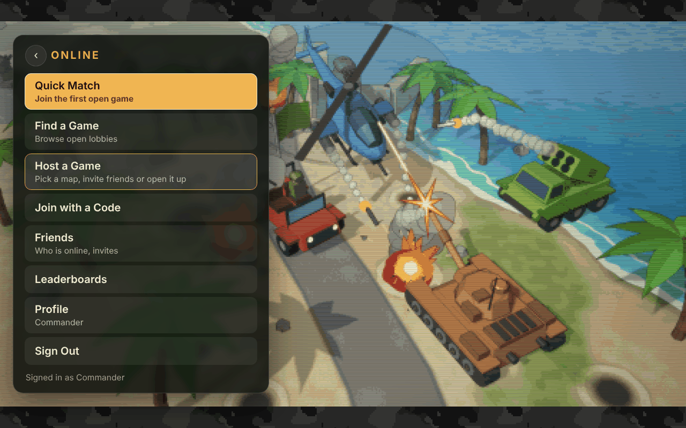
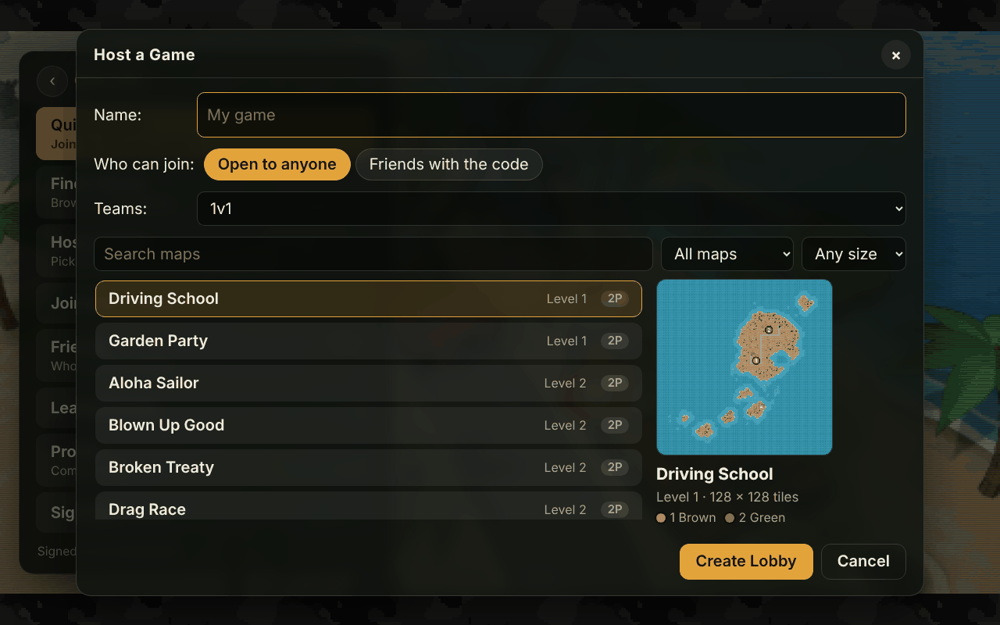
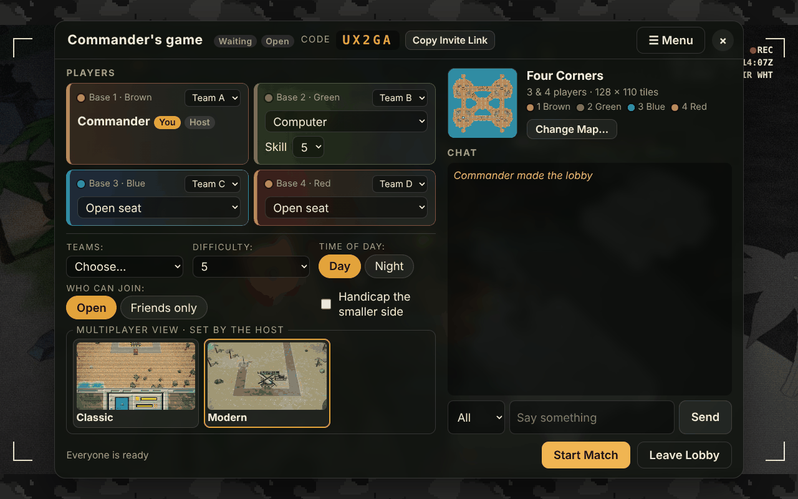

# Online Play

Online matches are for one to four players on maps with two to four bases, with bots in any empty seat. The rules are the same as offline ([[Game Rules]]).

## Accounts

Online play needs an account. Training, Two Players, replays and the level editor do not, and anyone can read the leaderboards.

Sign up under **Online > Create an Account** with a name, an email address and a password. The site sends no email: if you forget your password, ask one of the site's admins for a one-time reset code.

The site's owner decides whether sign-ups are open, invite-only or closed.

## Finding a match

Everything is under **Online** in the main menu.

*The Online menu, signed in.*

| Item | Does |
| --- | --- |
| Quick Match | Joins an open lobby that has room, or makes one |
| Find a Game | Lists open lobbies with their map, host, seats and state. Join or Watch any of them |
| Host a Game | Makes a lobby you own |
| Join with a Code | Joins a private lobby. An invite link does the same |
| Friends | Your friends, what they are doing, requests and invites |
| Leaderboards | The ladder and the fastest solo wins on each map |
| Profile | Your account and stats |

## Lobbies

A lobby has one seat for each base on its map, up to four. Each seat is open, closed, a player, or a bot with its own skill. Any base nobody takes is played by a bot.

The lobby's owner picks:

- **The map:** the built-in maps by level, the three and four base maps, their own library maps and public shared maps.
- **The team layout:** free for all, 2v2, 2v1, 2v1v1 and so on, or any team per seat.
- **The difficulty** of the bots.
- **Open or private.** An open lobby is listed. A private one needs its code or invite link.
- **Handicap for the smaller side**, off by default.
- **Visuals:** each player's choice (the default), classic for all, or modern for all.
- **Lighting:** each player's choice (the default), day for all, or night for all, in the modern view.

*Host a Game: name the lobby, choose who can join and the teams, and pick a map from the list with its preview.*

*A lobby. Each base has a seat card, the code and invite link are at the top, and chat is on the right.*

When every player is ready, the owner starts the match. Others can watch as spectators. After the match the results show and the lobby is ready for a rematch.

## In a match

- **Chat:** T opens the chat line. Tab switches between everyone, your team and one player. Right-click a message to report it or block its sender.
- **Scoreboard:** hold Tab.
- **No pausing.** The match is shared, so P does nothing online.
- **Out of the match?** You stay as a watcher following a teammate, and you can still chat.

## Dropped connections

The game reconnects by itself. Your seat is held for a minute, and a friends' game pauses while it waits. After that a bot plays your seat. Come back before the end and you take it over again.

## Friends

Ask someone by their player name under **Online > Friends**. Once they accept you are friends both ways. From the list you can join a friend's lobby, watch their game, or invite them to the lobby you are in. Invites work for private lobbies too.

## Stats and the ladder

Your profile keeps your wins, losses, flags captured, vehicles lost and favourite vehicle. The ladder is an Elo rating that starts at 1000 and counts matches with at least two signed-in players on opposing teams.

## Saved replays

Signed in, the ☁ button on a replay saves it to your account, so you can watch it from any browser you sign in on.
